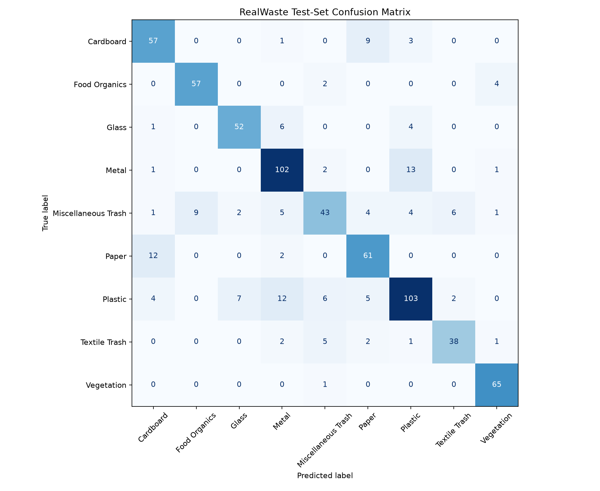

# Week 3 RealWaste Baseline Results

## Training configuration

- Model: ImageNet-pretrained ResNet18
- Output classes: 9 RealWaste classes
- Strategy: frozen backbone; trained final classification layer
- Epochs: 5
- Batch size: 32
- Learning rate: 0.001
- Training images: 3,323
- Validation images: 710
- Test images: 719
- Best validation accuracy: **76.3%**

## Held-out test performance

Overall test accuracy: **80.389%**

| Class | Accuracy |
| --- | ---: |
| Cardboard | 81.429% |
| Food Organics | 90.476% |
| Glass | 82.540% |
| Metal | 85.714% |
| Miscellaneous Trash | 57.333% |
| Paper | 81.333% |
| Plastic | 74.101% |
| Textile Trash | 77.551% |
| Vegetation | 98.485% |

## Failure cases to investigate

- Miscellaneous Trash is the weakest class and is confused with several visually different categories, especially Food Organics and Textile Trash.
- Paper is frequently confused with Cardboard (12 test images).
- Metal and Plastic are confused in both directions: 13 Metal images were predicted as Plastic, and 12 Plastic images were predicted as Metal.
- Plastic is also confused with Glass, Miscellaneous Trash, Paper, and Cardboard.

These results establish the fixed baseline for the Week 3 improvement experiment. The next experiment should change one factor and evaluate it on the same 719-image test set.

