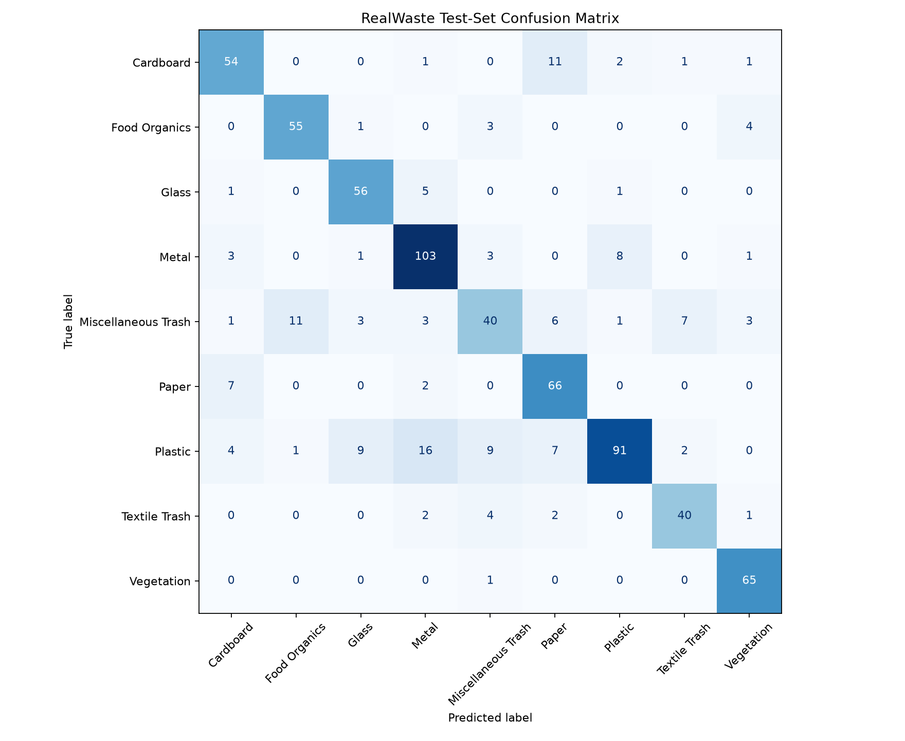

# Week 3 Class-Weighted Loss Results

## Experiment

Same configuration as the Week 3 baseline (frozen ResNet18 backbone, 5 epochs, batch size 32, learning rate 0.001). The only change: class-weighted cross-entropy loss, with weights computed from the training split as total / (9 × class count).

| Class | Weight |
| --- | ---: |
| Cardboard | 1.1467 |
| Food Organics | 1.2865 |
| Glass | 1.2559 |
| Metal | 0.6677 |
| Miscellaneous Trash | 1.0671 |
| Paper | 1.0549 |
| Plastic | 0.5733 |
| Textile Trash | 1.6632 |
| Vegetation | 1.2106 |

Run with: `python ml/train.py --freeze-backbone --class-weights --output models/resnet18_weighted.pt`

## Results on the same 719-image test set

| Class | Baseline | Weighted | Change |
| --- | ---: | ---: | ---: |
| Cardboard | 81.4% | 77.1% | −4.3 |
| Food Organics | 90.5% | 87.3% | −3.2 |
| Glass | 82.5% | 88.9% | +6.3 |
| Metal | 85.7% | 86.6% | +0.8 |
| Miscellaneous Trash | 57.3% | 53.3% | −4.0 |
| Paper | 81.3% | 88.0% | +6.7 |
| Plastic | 74.1% | 65.5% | −8.6 |
| Textile Trash | 77.6% | 81.6% | +4.1 |
| Vegetation | 98.5% | 98.5% | 0 |
| **Overall** | **80.4%** | **79.3%** | **−1.1** |

Best validation accuracy: 76.9% (baseline 76.3%).
Balanced accuracy (mean of class accuracies): 80.8% (baseline 81.0%).

## Findings

- Class weighting did not improve the model: overall accuracy dropped by 8 test images, and balanced accuracy was unchanged.
- Textile Trash improved slightly (+2 images), but Plastic dropped by 12 images, mostly to Metal (16 Plastic → Metal, up from 12).
- Most per-class changes are 2–5 images, within run-to-run noise.
- The weakest classes (Miscellaneous Trash, Plastic) struggle because they look like other classes, not because they have too few images.
- Disposal-level accuracy for the weighted model is 92.2%: many class errors (e.g., Plastic → Metal) still land in the correct bin. Miscellaneous Trash is the main bin-level problem, since 11 of its test images are predicted as Food Organics, which would send them to compost.

## Decision

Keep the unweighted model as the baseline. `--class-weights` remains in `train.py` as an off-by-default option so this experiment can be reproduced.

## Possible next experiments

- Train for more epochs (validation accuracy was still rising at epoch 5).
- Fine-tune the full network with a lower learning rate (1e-4).
- Add training augmentation to reduce reliance on the concrete background.
- Report disposal-category accuracy in `evaluate.py`, and compare the baseline on it.

