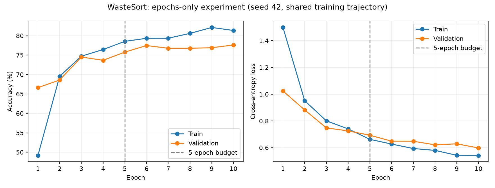

# Week 4 experiment 1: training budget only

## Predeclared design

Compare **5 versus 10 training epochs**, holding architecture, ImageNet initialization,
training examples, validation examples, class order, batch size (32), Adam learning
rate (0.001), unweighted cross-entropy and preprocessing constant. Use seed 42 and a
shared training trajectory: the 5-epoch arm is precisely the first five epochs of
the 10-epoch arm. This removes random initialization and early minibatch-order
variation from this paired comparison.

The historical baseline checkpoint lacks optimizer state and a recorded random seed.
It is preserved and used only as historical context, not as the controlled 5-epoch
arm. This experiment starts from ImageNet weights, not the existing trained checkpoint.

Match existing `train.py` behavior, including its subtlety: backbone parameters are
frozen, but BatchNorm running statistics still update when `model.train()` is called.
Changing that behavior would introduce a second factor, so it is deliberately kept.
No data augmentation, class-weight changes, or test-label changes are introduced.

## Selection and evaluation

Primary selection uses the highest **validation accuracy** within each budget,
keeping the earlier epoch on ties. The experiment therefore compares *up to* 5
against *up to* 10 epochs, as in the original best-checkpoint training procedure;
it does not require the last epoch to be the best one. Choose the 10-epoch budget
only if its best validation accuracy is strictly higher; otherwise keep 5 epochs.
Report losses and the full learning curve as additional context.

After selection is fixed, evaluate each selected checkpoint once on the existing
719-image held-out test set for descriptive comparison. This set has already been
examined previously; it is not a fresh blind holdout and not external data. Do not
change training settings in response to these test results during this experiment.
A single seed does not establish that the effect generalizes across random seeds.
External-photo performance remains unmeasured because independent photos are absent.

## Reproduction

From the repository root (CPU; installed requirements; dataset and pretrained
weights required), use fresh directories:

```bash
TORCH_HOME="$PWD/.torch" python3 -u ml/epoch_experiment.py \
  --seed 42 \
  --output-dir reports/week4_epochs_seed42/run \
  --model-dir models/week4_epochs_seed42
```

Existing output/model directories are rejected. The run writes per-epoch loss,
accuracy and elapsed time to history.csv and stores configuration, source/split
hashes, versions and checkpoint hashes in config.json. Checkpoints are saved in
models/ and remain excluded from Git. No baseline file is overwritten.

## Results

Completed all 10 epochs on CPU. No test-set feedback was used during training.

| Model | Best epoch | Validation accuracy | Held-out test correct | Held-out test accuracy | Disposal accuracy |
| --- | ---: | ---: | ---: | ---: | ---: |
| Historical baseline (different/unrecorded seed) | 5 | 76.338% | 578 / 719 | 80.389% | 93.602% |
| Controlled 5-epoch budget | 5 | 75.775% | 568 / 719 | 78.999% | 92.907% |
| Controlled 10-epoch budget | 10 | 77.606% | 587 / 719 | 81.641% | 94.019% |

The validation rule selects the **10-epoch budget**. The paired validation gain is **+1.831 percentage points**; the descriptive test gain is **+2.643 points** (+19 correct images).
On paired test predictions, 44 errors from the 5-epoch model become correct, while 25 previously correct predictions become wrong.

This is one controlled seed, not evidence of a reliable improvement across seeds or external photos. The historical baseline is not the control arm; its difference cannot be attributed solely to epoch count.



### Per-class held-out test recall

| Class | 5-epoch budget | 10-epoch budget | Change (percentage points) |
| --- | ---: | ---: | ---: |
| Cardboard | 91.429% | 87.143% | -4.286 |
| Food Organics | 88.889% | 90.476% | +1.587 |
| Glass | 63.492% | 87.302% | +23.810 |
| Metal | 78.992% | 84.034% | +5.042 |
| Miscellaneous Trash | 53.333% | 57.333% | +4.000 |
| Paper | 76.000% | 78.667% | +2.667 |
| Plastic | 84.892% | 79.137% | -5.755 |
| Textile Trash | 71.429% | 83.673% | +12.245 |
| Vegetation | 96.970% | 92.424% | -4.545 |

The largest gain is Glass (+15 correct images); Textile Trash and Metal each gain
6. Plastic loses 8 correct images, while Cardboard and Vegetation each lose 3.
Thus the aggregate gain is not uniform. Miscellaneous Trash remains at 57.333%
recall, the same as the historical baseline, so longer training has not resolved
that weak class. Keep the original baseline available and treat the 10-epoch model
as the validation-selected candidate for further independent-photo testing.

### Evidence and validation

- [Per-epoch history](../reports/week4_epochs_seed42/run/history.csv)
- [Configuration and checkpoint/source hashes](../reports/week4_epochs_seed42/run/config.json)
- [5-epoch predictions](../reports/week4_epochs_seed42/test_5epochs/predictions.csv) and [summary](../reports/week4_epochs_seed42/test_5epochs/summary.json)
- [10-epoch predictions](../reports/week4_epochs_seed42/test_10epochs/predictions.csv) and [summary](../reports/week4_epochs_seed42/test_10epochs/summary.json)
- [Paired comparison](../reports/week4_epochs_seed42/comparison.json)
- [44 corrected and 25 newly wrong images](../reports/week4_epochs_seed42/changed_correctness.csv)

All five existing unit tests passed. New scripts passed compilation checks. Error inventory checks verified 141 errors, 46 disposal errors, descending confidence and 141 valid gallery image links. Final checkpoint epoch/validation values were checked against the history; the historical checkpoint SHA-256 remained unchanged.

The trained checkpoints remain local at `models/week4_epochs_seed42/best_5epochs.pt` and `models/week4_epochs_seed42/best_10epochs.pt`; neither is pushed or included in Git. The historical default checkpoint is unchanged. Training source files are in commit `bc98d84`; config.json records the earlier base revision plus exact source hashes.

Post-selection test commands:

```bash
python3 ml/test_images.py --kind realwaste_held_out_test --checkpoint models/week4_epochs_seed42/best_5epochs.pt --output-dir reports/week4_epochs_seed42/test_5epochs
python3 ml/test_images.py --kind realwaste_held_out_test --checkpoint models/week4_epochs_seed42/best_10epochs.pt --output-dir reports/week4_epochs_seed42/test_10epochs
```
