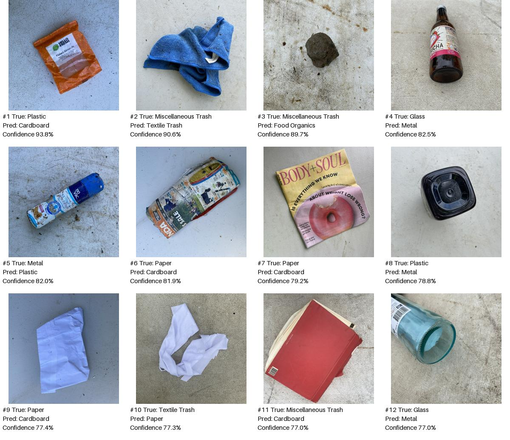

# Week 4: baseline error review

Analysis of the existing baseline's 719 held-out RealWaste predictions, not external
photos. The checkpoint and test labels are unchanged. The review is descriptive;
visual observations below are hypotheses, not proven causes of model decisions.

## Deliverables

- [All 141 errors, descending confidence](../reports/week4_error_analysis/errors.csv):
  original prediction fields, disposal correctness, and an empty review_note column
  for the team to fill as they review each image.
- [Local image gallery](../reports/week4_error_analysis/index.html): all 141 images,
  true/predicted labels, confidence and disposal error indication. Open locally with
  the dataset present in its existing location; GitHub does not host the ignored data.
- [Twelve highest-confidence errors](../reports/week4_error_analysis/top12_errors.jpg).
- [Visual observations for those 12 examples](../reports/week4_error_analysis/reviewed_top12.csv).
- [Complete class and confusion-pair counts](../reports/week4_error_analysis/summary.json).



## Findings

There are **141 class errors out of 719 images**, of which **46 also give the wrong
disposal category** under the project's mapping. The remaining 95 class errors map
to the same disposal category. Two incorrect predictions have confidence at least
90%; high confidence does not guarantee correctness.

| Actual class | Errors / support | Error rate |
| --- | ---: | ---: |
| Cardboard | 13 / 70 | 18.57% |
| Food Organics | 6 / 63 | 9.52% |
| Glass | 11 / 63 | 17.46% |
| Metal | 17 / 119 | 14.29% |
| Miscellaneous Trash | 32 / 75 | 42.67% |
| Paper | 14 / 75 | 18.67% |
| Plastic | 36 / 139 | 25.90% |
| Textile Trash | 11 / 49 | 22.45% |
| Vegetation | 1 / 66 | 1.52% |

Plastic has the most errors by count, while Miscellaneous Trash has the highest
error rate. Leading directional confusions are Metal → Plastic (13), Paper →
Cardboard (12), Plastic → Metal (12), Cardboard → Paper (9), and Miscellaneous
Trash → Food Organics (9). The last pair also changes Landfill to Compost.

The 12 highest-confidence errors were visually inspected. Printed/folded packaging
and paper often have similar shapes; dark glossy plastic and bottles can have
material cues resembling metal. A blue cloth-like example is labeled Miscellaneous
Trash but predicted Textile Trash, and a book-like object is also in Miscellaneous
Trash. These warrant checking class definitions and annotation boundaries. They do
not establish that the dataset labels are wrong, and no test labels were changed.
Only these 12 have individual visual observations; the other 129 are organized for
review, not claimed to have been individually diagnosed.

## Next steps and limits

Use the gallery to discuss label boundaries and examples, but investigate proposed
training changes on train/validation data. Do not relabel this test set to improve a
score. Background reliance cannot be established from this montage: test independent
photos and controlled background changes in a separate experiment. The current
first experiment changes only the training budget (5 versus 10 epochs), not labels,
augmentation, class weighting, or preprocessing.

Rebuild the inventory/gallery with a fresh output directory:

```bash
python3 ml/review_errors.py --output-dir reports/week4_error_review_repeat
```

The montage copies 12 dataset images for review; the full dataset and weights remain
excluded from Git. Original input images are never modified.
